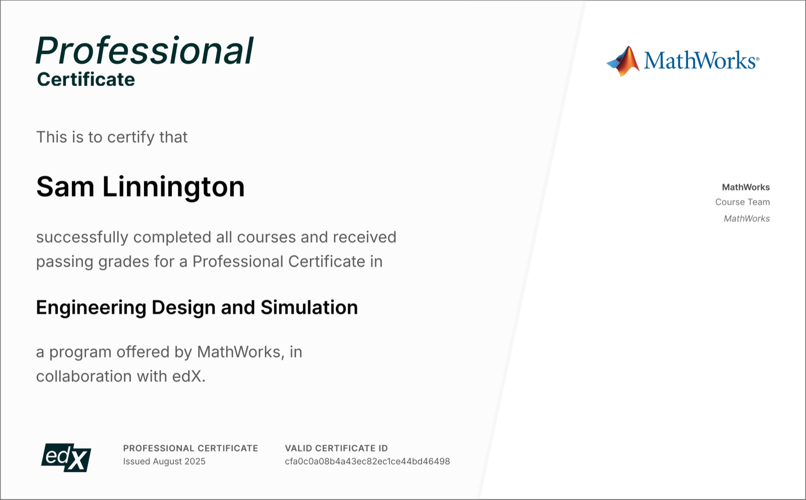

# Certificates

## Engineering Design and Simulation

<dl class="pf-project__facts">
  
<dt>Issued by</dt><dd>MathWorks, via edX</dd>

  
<dt>Completed</dt><dd>Jul – Aug 2025</dd>

  
<dt>Format</dt><dd>Professional Certificate, four courses</dd>

</dl>

<ul class="pf-chips">
  <li>MATLAB</li>
  <li>Simulink</li>
  <li>Simscape</li>
  <li>Multi-domain modeling</li>
  <li>Digital twins</li>
  <li>System verification</li>
</ul>

A four-course program that builds from Simulink and Simscape fundamentals to a complete,
system-level quadcopter model: a multi-domain digital twin that can be tested and refined before
any hardware exists.

1. **Introduction to Engineering Design.** Core modeling workflows in Simulink and Simscape, and
   using simulation to answer engineering questions.
2. **Simulating a Quadcopter's Flight.** Modeling the mechanical subsystems and analyzing flight
   dynamics.
3. **Simulating a Quadcopter's Electromechanics.** Integrating the mechanical and electrical
   domains and tuning system performance.
4. **Assembling and Testing a Quadcopter.** System-level integration and scenario-based testing,
   including troubleshooting problems such as mismatched motor torque.

**Result:** a working digital twin of a quadcopter that combines flight dynamics with the
electromechanical drive, verified through scenario-based tests.

<figure class="pf-cert" markdown="span">
  
  <figcaption><a class="pf-external" href="https://credentials.edx.org/credentials/cfa0c0a08b4a43ec82ec1ce44bd46498/">Verify on edX</a></figcaption>
</figure>
