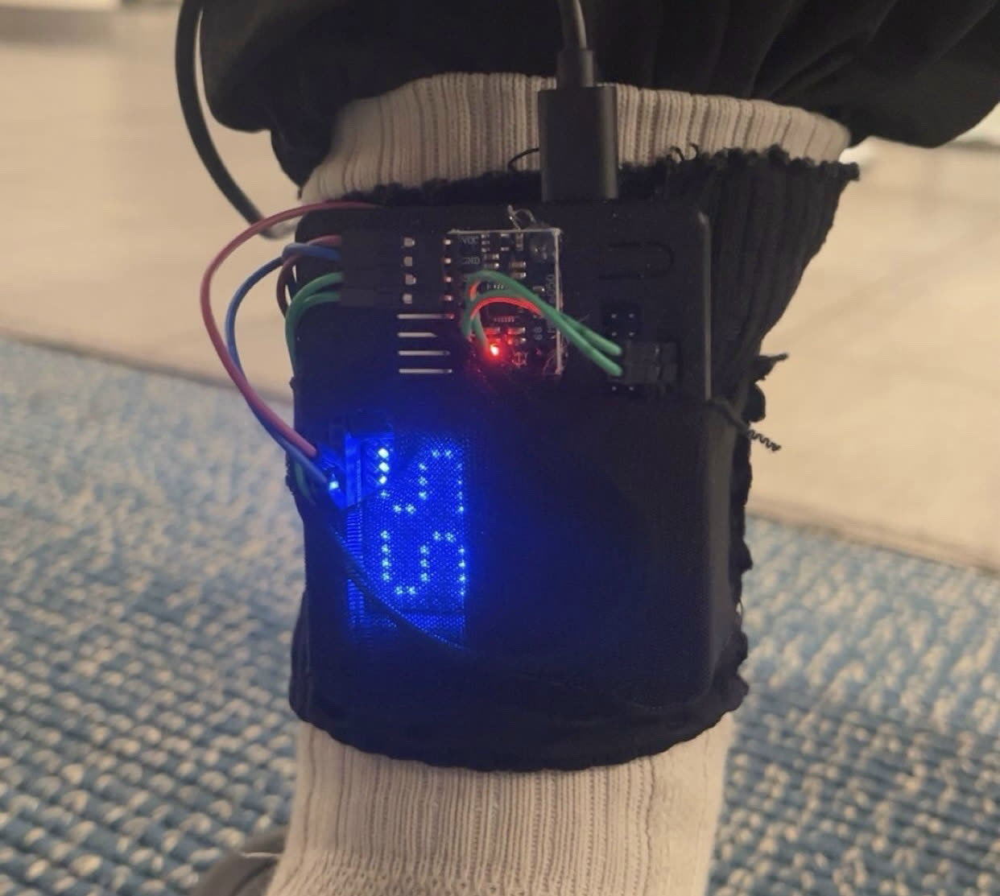
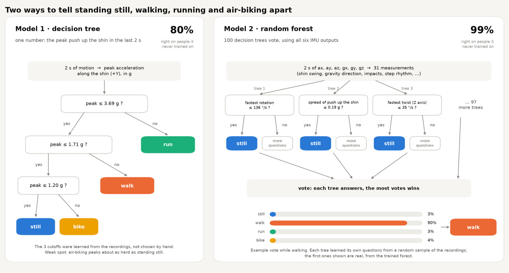

!!! abstract "TL;DR"
    Built a shin-worn wearable on an Arduino UNO Q that tells standing, walking, running and
    air-biking apart (99% correct on people it never trained on) and counts steps with an
    8,721-weight neural network, within about 2% median error on new people. It streams live to a
    dashboard that turns the count into a distance estimate with an honest error range.

## Challenge

The wearable had to work live for classmates, on bodies and gaits it had never seen, not just mine.
That ruled out tuning anything by hand: every model was judged on people left out of its training.
Counting steps added harder problems. There is no record of when a foot lands unless someone makes
one, the phone used as a second sensor sits at an arbitrary angle in a pocket, and air-biking swings
the leg in a steady rhythm much like walking without taking a single step. The rule-based counter I
started with logged 106 false steps a minute while air-biking.

## Labor & Results

### Intro and demo

<figure>
<video src="img/demo.mp4" poster="img/demo.jpg" width="720" height="1280" controls preload="none" playsinline></video>
<figcaption>Demo: walking, stairs and air-biking, with the live dashboard</figcaption>
</figure>

<figure markdown="span">
  
  <figcaption>On the right shin: the UNO Q, the MPU-6050 and the LED matrix showing the current class</figcaption>
</figure>

The first version of the wearable classified standing, walking, running and air-biking with two
non-neural models, a decision tree and a random forest. The second version also counts steps,
using a 1D convolutional neural network trained in PyTorch. To use every sensor available, I added
my iPhone in my left front pocket alongside the MPU-6050 on my right shin, wired to an Arduino UNO
Q, so the left and right legs are measured independently. Six people carried out a series of
recordings (walking and running at varying paces and cadences, climbing stairs, air-biking) while I
tapped the F and J keys at every footfall. The network was trained on those taps on my laptop, and
the trained weights then run live on the UNO Q, which shows the movement class on its LED matrix
and streams data to the dashboard over MQTT. The dashboard shows the step count, the cadence, and
an estimate of how far you walked, with a range for how sure it is.

-   **99 %**

    activity classification accuracy on people the model never trained on (random forest)

-   **~2 %**

    median step-count error per session on new people (9 in 10 sessions within 13.5%)

-   **0.35 / min**

    false steps while air-biking, down from 106 / min with the rule-based counter

-   **8,721**

    weights in the step-counting network, small enough to run on the board in plain numpy

### Classifying movement

**Model 1** is a decision tree on the hardest push up the shin within each 2-second window. The
model learned three cutoffs: below 1.2 g is still, below 1.7 g is bike, below 3.7 g is walk, and
anything harder is run. It gets 80% right on people it never trained on.

**Model 2** is a random forest of 100 decision trees, each trained on a different random sample of
the data, that vote. They use all six sensor readings, turned into 31 measurements such as how much
the shin swings, which way gravity points, and the step rhythm. It classifies movement correctly
99% of the time on people it never trained on.

<figure markdown="span">
  
  <figcaption>The two activity classifiers</figcaption>
</figure>

### Counting steps with a neural net

The step counter is a small neural network with 8,721 weights. For every moment (100 per second)
it takes in 12 numbers: seven from the shin (its six sensor axes plus overall acceleration) and five
from the phone, measured relative to gravity so it doesn't matter which way the phone sits in my
pocket (up, side, turn, swing, and whether the phone is connected). The net has four layers, each
one sliding a small filter of weights along the signal, and each layer's filter is spread twice as
wide as the last one's, so together they see about 0.6 s on either side of every moment. After each
layer, a ReLU activation zeroes out any negative values. A final sigmoid squashes the output into a
0–1 probability that a foot is hitting the ground right then. Every peak above 0.5, and at least
0.2 s from the last one, counts as a step.

To train it, I turned each of my F and J key taps into a narrow bump. The "correct answer" is then a
peak at every footfall and zero everywhere else. Training repeats one loop. First, grab 64 random
4-second clips, randomly tilted, sped up or slowed down, and rescaled, with the phone hidden 30% of
the time so the net doesn't rely on it. Next, run the clips through the net and score how wrong it
was with a loss, then have backpropagation run the chain rule backwards through the layers to find
how much each weight contributed to that error. Gradient descent nudges every weight slightly in the
direction that lowers it. The learning rate sets how big each nudge is: it starts at 0.003 and
shrinks toward zero by the end, so the net settles in instead of overshooting. One epoch is 100 of
these updates, and I trained for 25 epochs, 2,500 updates in all.

<figure>
<video src="img/step-counter-system.mp4" poster="img/step-counter-system.jpg" width="1280" height="720" controls preload="none" playsinline></video>
<figcaption>Walkthrough of the step counter: sensors, inputs, network, training loop</figcaption>
</figure>

As with the classifiers, I tested it leave-one-person-out: train on five people, test on the sixth,
and repeat for everyone. Even the 0.5 cutoff was chosen using people the net hadn't trained on. On
those new people it gets a median count error of about 2% per session (against 2.6% for the earlier
rule-based counter), and 9 out of 10 sessions are within 13.5%. The trained weights are saved to a
file and run on the UNO Q in plain numpy, matching PyTorch to within 0.000000007, so steps show up
on the dashboard live, about 1.3 s after they happen.

### Distance

Distance is estimated as steps × step length and shown as a range rather than a single number.
The step count comes from the neural net, but the board has no way to measure step length, so a
step is estimated at about 0.37–0.45 × your height when walking and 0.5–0.8 × when running. If no
height is entered, it assumes someone between 155 and 195 cm. That makes the uncalibrated range
about ±20% walking, and wider running. Calibrating over a measured distance tightens the range to
about ±8%, plus the net's own counting error.

### Watching it learn

A [timelapse of the training process](https://sl-ter.github.io/me193/ActivityWearable/timelapse.html){ .pf-external }
shows what training actually does. I re-ran one round with one participant's recordings held out
and saved about 280 snapshots of the network along the way, more of them early on, when it changes
fastest. The timelapse plays them back like a video over 8 seconds of four of that person's
recordings: walking, stairs, a fast run and air-biking. At the start, the output is random noise.
Within a few hundred updates it forms one sharp peak at each tap, while the air-bike line stays
flat. Alongside it, the loss falls on both the training clips and the held-out recordings, which the
net never trained on. The last frame matches the real training run exactly: 372 steps counted
against 368 taps.

## Reflection

The biggest lesson was how easily my own data could flatter me. When I first tuned the step
threshold on the same people the net had trained on, it came out at 0.60, and it undercounted
everyone new: the net is more confident on people it has seen. Choosing it only from held-out
output fixed that, and leave-one-person-out testing became the rule for every number on this page.
Next time I'd put a second IMU on the other shin instead of relying on a phone, and find a way to
measure step length directly, since distance is now the weakest output: the count is within a few
percent, but uncalibrated distance is only good to about ±20%.
