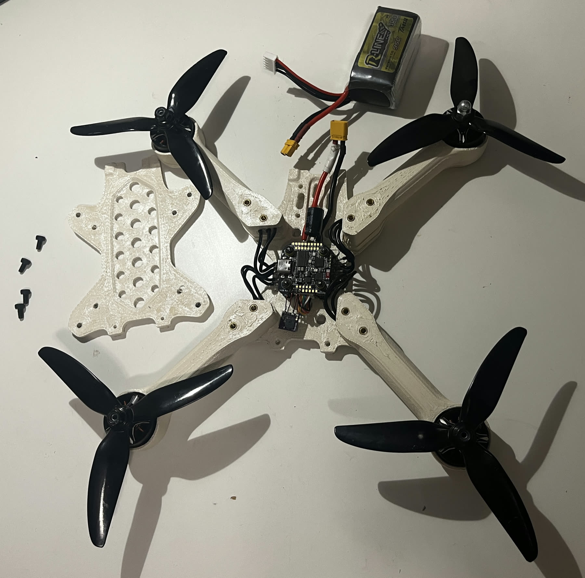
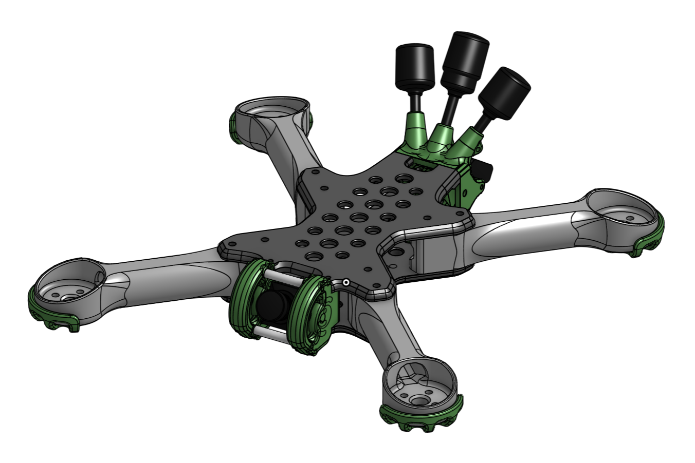

!!! abstract "TL;DR"
    Designed, built and flight-tested a modular 5-inch quadcopter with a Tullomer frame, then wrote
    a comprehensive report on the work and a three-part material testing plan (RF transparency,
    structural efficiency, vibration behavior) for benchmarking Tullomer against incumbents like
    carbon-fiber reinforced nylon and polycarbonate.

## Challenge

Tullomer is Z Polymers' proprietary crystalline polymer, printable on ordinary desktop 3D printers.
With a tensile strength of 250 MPa at a sixth of steel's density, and broad resistance to
environmental factors, it rivals traditional high-performance polymers like PEEK, PEKK, PAEK and
Ultem, which require expensive, specialized industrial printers. On paper it is radio-frequency
transparent (dielectric constant ≈ 3), light (1.4 g/cm³) and stiff, which makes it a natural fit for
drone frames, especially where carbon fiber's conductivity forces pilots to route antennas around
it. At roughly $500/kg, however, against $30–80/kg for carbon-fiber reinforced nylon, it has to show
a measurable advantage before anyone will build with it.

Demonstrating that first required a drone that flew reliably and could swap frame parts between
materials without changing their geometry. The original plan was to build the drone and then run the
material tests, but learning and configuring the entire system, along with troubleshooting
unfamiliar hardware, took the whole of the project. A drone had been partly developed at the company
before, but nothing had ever flown, and there was no documentation of the earlier work or of the
many faulty electronic components in-house (worn motors, a freezing transmitter, a faulty flight
controller and more).

## Media

<figure>
<video src="img/flight-test.mp4" poster="img/flight-test.jpg" width="1080" height="1920" controls preload="none" playsinline></video>
<figcaption>Flight test, August 2026</figcaption>
</figure>

<figure markdown="span">
  
  <figcaption>Top plate off: the SpeedyBee F405 stack, wiring and threaded inserts in the Tullomer arms</figcaption>
</figure>

<figure markdown="span">
  
  <figcaption>Onshape model of the frame</figcaption>
</figure>

## Labor & Results

- **Design:** Adopted an open-source 5-inch modular frame
  ([Leopard FPV Drone](https://www.printables.com/model/1517629-leopard-fpv-drone){ .pf-external })
  whose arms and center plates all bolt apart, so any piece can be reprinted in a different
  material and swapped in. Built editable Onshape models of the arms to allow future geometry
  changes. Kept the 5-inch propeller class: small enough to fly in tight spaces, but large enough
  for material tests against commercial and defense FPV platforms.
- **FFF 3D Printing:** Printed the entire frame in Tullomer, along with several candidate parts of
  the same geometry in PLA, PETG and nylon. Parts for incumbent-material testing weren't printed
  yet, as print parameters hadn't been fully standardized by the end of my time with the company.
- **Electronics integration and troubleshooting:** Wired and soldered the full stack: a SpeedyBee
  F405 flight controller with its coupled 35 A SpeedyBee electronic speed controller, an ExpressLRS
  receiver, an XT30 power lead with a 470 µF input capacitor, and the motors and connectors. Faulty
  components were the scourge of this project. I tracked down a radio link that kept failing across
  several receivers and flight controllers: when the receiver and transmitter were power-cycled
  separately, the link only dropped after the receiver restarted, which put the fault on the
  transmitter side. I replaced burnt motors, soldered new connectors, swapped undersized motors for
  stronger ones, retired a flight controller with a broken receiver pad, and bypassed a burnt ground
  pin by soldering straight to the board. This project was a head-first dive into electronics and
  their integration.
- **Firmware management:** Matched ExpressLRS firmware at 3.3.1 on both the receiver and transmitter
  sides of the RF link, configured the EdgeTX transmitter (stick calibration, ADC filter off to stop
  stepped commands and motor jitter), and documented the binding procedure for whoever picks the
  project up next.
- **Betaflight (software) configuration:** Set up CRSF serial receiver input, the motor protocol,
  motor stop, arm and flight-mode switch ranges, and a props-out motor spin direction, which keeps
  debris off the camera and improves crash recovery.
- **Power-system management:** After moving up to Surpass Hobby S2207 2550 KV motors, checked every
  current path against its rating. The 15 A motor connectors and 30 A battery connector had been
  sized for the old, smaller motors, well under the new motors' ~35 A rating. At full throttle on
  5×4.8 props each motor pulls 46 A, beyond the ESC's 35 A continuous / 45 A burst rating. The
  850 mAh 95C battery tops out around 81 A, while the quad can ask for more than 100 A. The result
  was a tiered upgrade plan: a 75% output cap now, MR60/XT60 connectors and 1300 mAh packs next,
  and a 30×30 stack long-term.
- **Design of experiments:** Wrote the methods for all three tests, each with its own metrics:
    - **RF transparency:** three options by level of equipment investment, from free link-quality
      tests on the drone's own radio up to NanoVNA insertion-loss and antenna-detuning measurements.
    - **Structural efficiency:** drop tests reported against impact energy (m·g·h) rather than drop
      height, so a heavier arm isn't mistaken for a stronger one, plus crash tests for a more
      realistic picture.
    - **Vibration behavior:** Blackbox accelerometer and gyro logs analyzed with FFTs and
      spectrograms.
- **Results:** A flight-validated platform, plus a 13-page handoff report and final presentation for
  Z Polymers. Material testing wasn't run during the internship; the report sets the hardware
  baseline and the order of work for whoever takes it on next.

## Reflection

Most of the summer went to getting a reliable drone in the air rather than testing the material.
Part of that was the faulty inherited hardware, and part of it was learning drone engineering from
the ground up, along with the basics of soldering, electronics and configuration. With more time,
I'd buy bench RF equipment (a ~$200 NanoVNA) and move on to material testing. RF transparency is
Tullomer's clearest advantage, and an instrument-grade insertion-loss number for Tullomer against
carbon-fiber nylon could be measured in a week, an insight I wish I'd had sooner.
